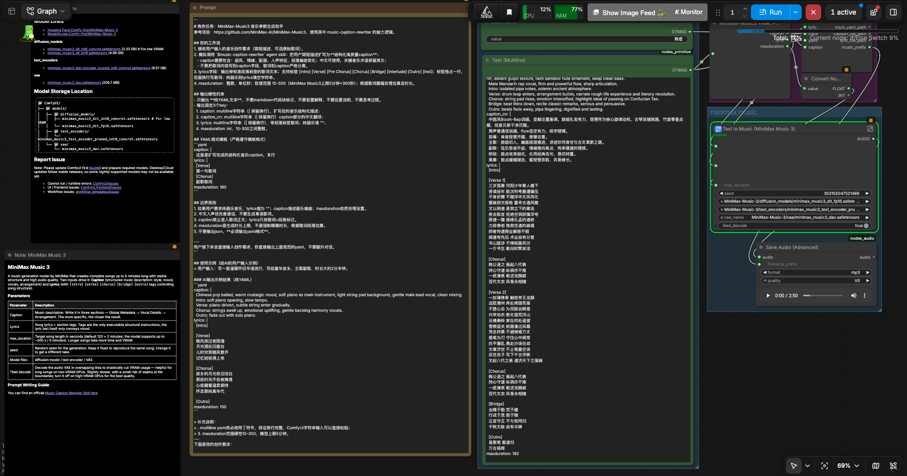

# comfyui‑minimax‑music‑yaml‑parser
ComfyUI custom node for parse AI‑generated yaml parameters for MiniMax Music3.

## Feature
- Parse yaml multiline string, output 3 ports for MiniMax‑Music3 node:
  - `caption`: music style & arrangement description (STRING multiline)
  - `lyric`: song lyrics with section tags like [Verse] [Chorus] (STRING multiline)
  - `maxduration`: int, auto clamp range `10‑300` (MiniMax Music3 upper limit: 300 seconds / 5min)
- Fault‑tolerant: yaml parse error / missing keys will fallback to safe default values.

## Install
```bash
git clone https://github.com/feishengfei/comfyui_minimax_music_yaml_parser
cd comfyui_minimax_music_yaml_parser
pip install -e .
```

## Workflow


[workflow](workflow/minimax_music3_workflow.json)
